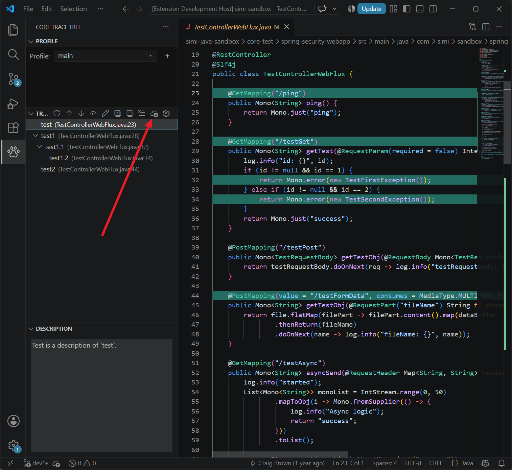
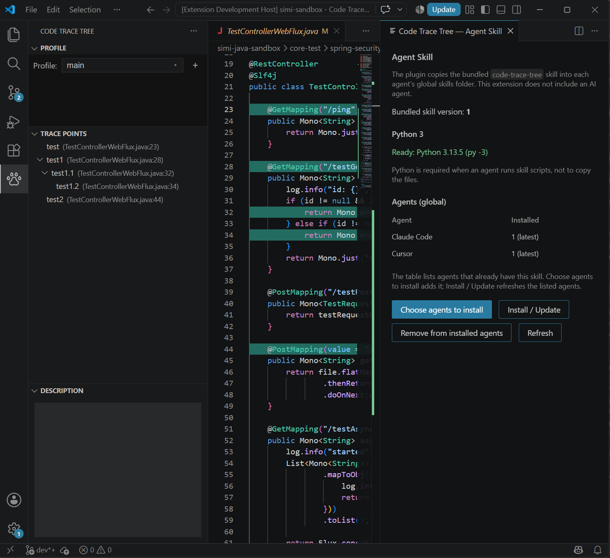

<p>
  <a href="https://open-vsx.org/extension/craigbrown/code-trace-tree">
    
  </a>
  <a href="https://marketplace.visualstudio.com/items?itemName=CraigBrown.code-trace-tree-vscode">
    
  </a>
</p>

# What's New

* **Project Binding Optimization**: Improved project binding preference to use `.idea/code-trace-tree.project.id` when present (read-only), falling back to workspace matching against global XML by `<path>`.
* **Empty-Tree Recover UI**: The "Import stored data" recovery UI now appears exclusively when another stored project contains trace points, and is automatically hidden after deletion or when nothing is importable.
* **Agent Skill Integration**: Refined toolbar integration, version synchronization, and status checks for seamless coding agent collaboration.

---

# Install the Extension with `vsix` file

1. Download the release `.vsix` file (`code-trace-tree-vscode-X.Y.Z.vsix`) from Codeberg releases.
2. In VS Code / Cursor: **Extensions** → `...` → **Install from VSIX…**
   (or Command Palette: `Extensions: Install from VSIX…`).
3. Choose the downloaded `.vsix` file.
4. Reload the window if prompted.

---

# Agent Skill

This extension does **not** ship an AI agent. Install your preferred coding agent, then install the Code Trace Tree skill. Once installed, the agent can **auto-load** it when your request is relevant. The skill is general—any agent that can load skill folders can use it (such as Claude Code, Cursor, GitHub Copilot, Codex, or Gemini CLI).

The skill lets the agent:

* Resolve the bound global storage XML for the project
* Search, add, move, and delete trace points
* Rebind line locations after source edits on disk
* Ask the IDE to reload / refresh plugin data
* Select or navigate to nodes in the Code Trace Tree view

## Agent Skill Installation

**Python 3 required:** skill scripts need **Python 3** on `PATH` (`python3` or `python`). **Choose agents** and **Install / Update** stay disabled until Python 3 is found. [Install Python 3](https://www.python.org/downloads/), add it to PATH, then restart the IDE.

Open the **Code Trace Tree** view and click **Agent Skill** on the toolbar (cloud download icon):



* The status page displays the bundled skill version, Python 3 availability, and agent installation statuses:
  * **Choose agents to install** — Select agents that do not have the skill yet.
  * **Install / Update** — Copies the bundled `code-trace-tree` skill into each selected agent's global skills folder (e.g., `~/.cursor/skills/code-trace-tree`).
  * **Remove from installed agents** — Deletes local copies from specified agents.



On first project open, if a detected agent lacks the skill or is outdated, a notification appears once per skill version (dismissing or opening the status page is saved in your global `settings.xml`).

ZIP archives and `npx skills` commands remain available on the [code-trace-tree-skill repository](https://github.com/saidake/code-trace-tree-skill) if needed.

## How to use the skill

In your agent chat, prompt naturally:

```
Help me generate some simple trace points related to the current topic.
```
